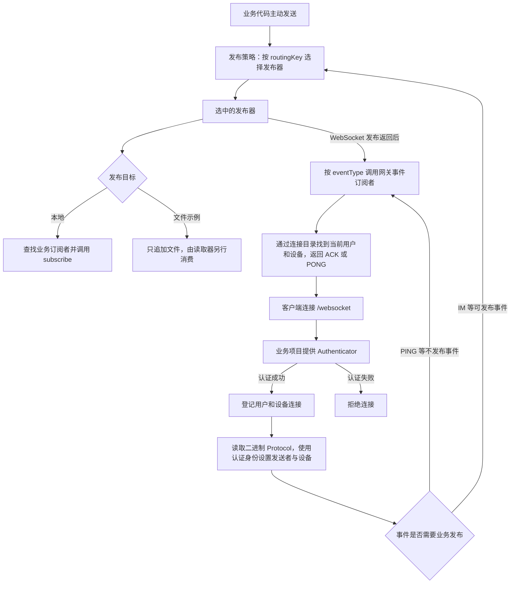
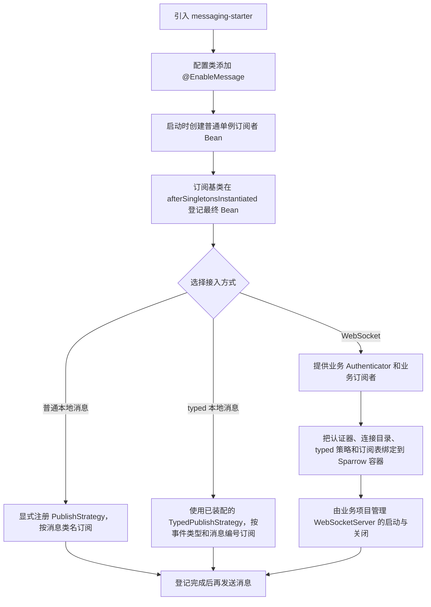
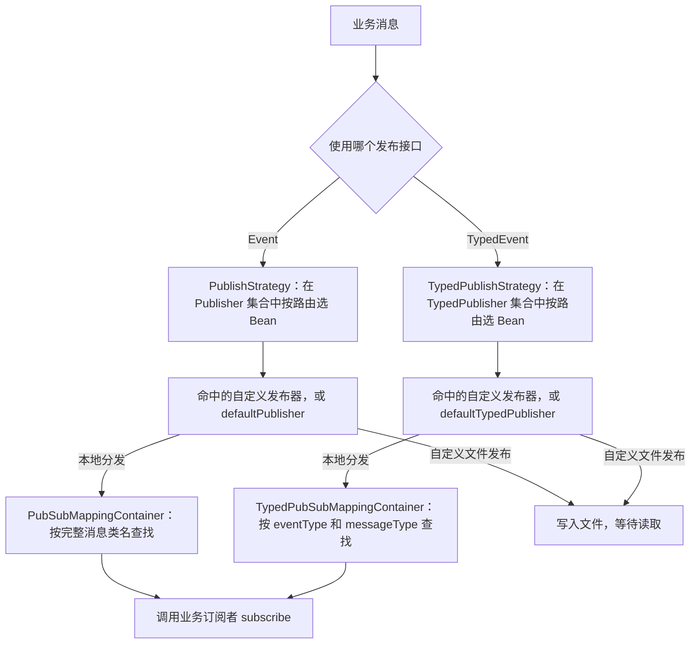
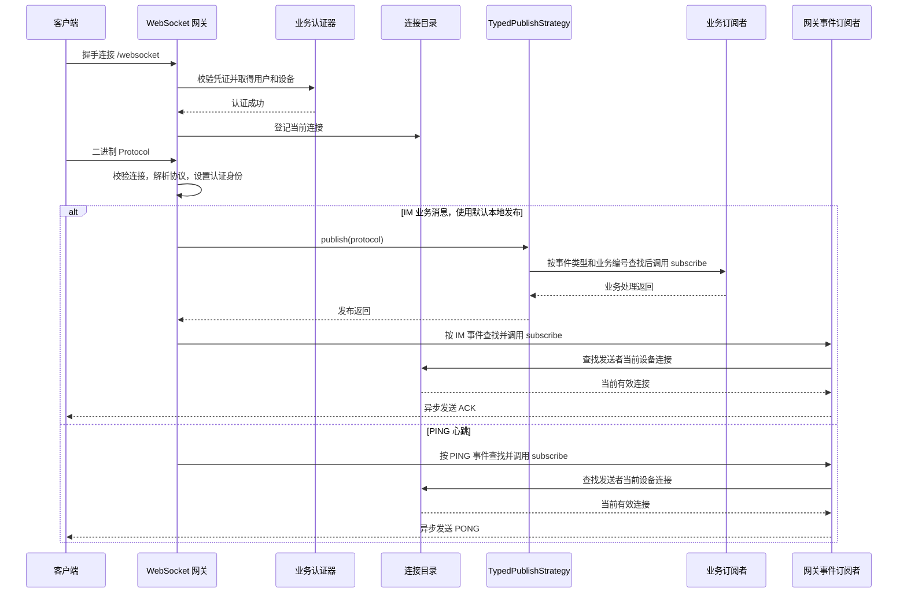
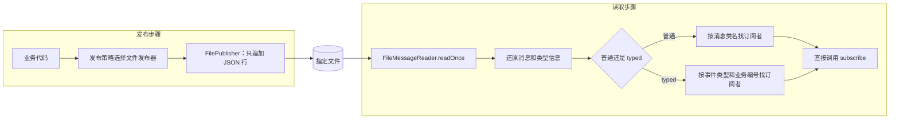

# Sparrow Messaging Gateway

消息网关负责连接管理、接收客户端消息，以及向客户端发送响应。业务权限、业务数据和消息处理规则由接入项目负责。

当前已实现本地发布订阅、按路由选择发布器、多设备连接管理，以及 Netty 二进制 WebSocket 接入。`messaging-example` 提供普通、typed、文件、心跳/回执和真实 WebSocket 示例。RocketMQ 模块暂未进入本阶段交付范围，不作为默认可用链路。

## 业务流程总览

业务项目负责认证、消息内容和处理规则；网关负责连接与收发。应用可以直接发布本地消息，也可以通过 WebSocket 接收客户端消息。



图中的“业务订阅者”和“网关事件订阅者”职责不同：前者执行业务处理，后者处理 ACK、PONG 等网关响应。业务异常时不会继续发送成功 ACK，连接会关闭。自定义发布器若只负责落文件或入队，返回只代表该发布步骤完成，不能据此认为后续消费者已经处理成功。

## 当前能力与边界

- `MultiDeviceConnectionRegistry` 按用户和设备登记连接，同用户同设备的新连接替换旧连接；旧关闭回调不会删除新连接。查询集合返回只读快照。
- `NettyWebsocketConnection` 提供异步发送和关闭；本地写完成不代表客户端已经确认收到。
- `WebSocketGateway` 解析二进制 `Protocol`，使用认证身份覆盖客户端填写的发送者和设备，再分发消息。IM 进入业务发布后生成 ACK；PING 返回 PONG。
- ACK 按当前用户和设备定位连接，因此重连后可以在新连接收到旧请求的 ACK，客户端应根据消息标识关联请求。ACK/PONG/状态发送的异步失败会记录 WARN，当前不自动重试。
- 单帧及分片合计上限为 **655360 字节（640 KiB）**，不启用压缩。连续 10 秒没有读到数据时关闭连接，客户端应保持相应心跳。
- 未支持的事件、损坏报文或业务处理异常会关闭连接；异常记录在服务端，不返回成功 ACK。可选首页资源没有提供时返回 HTTP 404。联系人在线状态目前仍是占位回复，不代表已实现真实查询。
- 消息持久化、离线消息、跨实例连接定位、可靠重发和生产容量尚不在当前实现承诺内。文件例子也不是生产消息队列。

## 模块

| 模块 | 职责 |
| --- | --- |
| `bom` | 依赖版本和公共构建配置，继承 Sparrow `infra-bom` |
| `messaging-protocol` | `Event`、`TypedEvent`、`Protocol`、用户/会话对象及发布订阅接口 |
| `messaging-domain` | 多设备连接目录、本地发布策略、发布器与订阅映射表 |
| `messaging-infrastructure` | Spring 订阅者基类、路由配置、Netty WebSocket 与网关事件处理 |
| `messaging-starter` | `@EnableMessage` 和 Spring 组件装配 |
| `messaging-example` | 可独立选择入口运行的接入示例 |
| `messaging-po`、`messaging-dao-api`、`messaging-dao-sparrow` | `SessionMessageSeed` 实体及现有 ORM 类型绑定；尚未实现领号、校准和恢复流程 |
| `messaging-adapter` | 保留的接入模块骨架，当前没有旧 HTTP 认证/聊天控制器 |
| `messaging-rocketmq-client` | 后续处理的 RocketMQ 适配模块 |

主链依赖为 `starter → infrastructure → domain → protocol`。基础模块的 Maven groupId 为 `com.sparrowzoo.messaging`，Java 接口位于 `com.sparrow.messaging`。

`messaging-po/bin` 的旧脚本和 SQL 仅作参考，不是当前种子表迁移脚本，构建不会执行。种子 DAO 的自然主键读写及数据库生成流程尚未联调。

## 构建和测试

需要 JDK 25+、Maven 3.8.6+，以及本地或内部仓库中的 Sparrow `1.0.0-SNAPSHOT` 依赖，包括父 POM、`infra-bom`、`sparrow-protocol`、`authenticator-core` 等传递依赖。

代码检查沿用 Sparrow 父项目规则。`SPARROW_STYLE_DIR` 应指向包含 `sparrow_checkstyle.xml` 和 `check_style_suppressions.xml` 的目录。

本项目 BOM 尚未由仓库提供时，先安装：

```bash
mvn -B -N -f bom/pom.xml install
```

在根目录执行编译、代码检查、测试及打包：

```bash
mvn -B clean verify -DskipTests=false
```

依赖已缓存时可离线执行：

```bash
mvn -o -B clean verify -DskipTests=false
```

这些检查不需要启动数据库、Redis 或 Broker。测试通过说明已覆盖的代码行为通过验证，不替代真实认证、网络和负载联调。

## Spring 接入

业务项目引入 `com.sparrowzoo.messaging:messaging-starter:1.0.0-SNAPSHOT`，配置：

```java
import com.sparrow.messaging.starter.EnableMessage;
import org.springframework.context.annotation.Configuration;

@Configuration
@EnableMessage
public class MessagingConfig {
}
```

`@EnableMessage` 装配连接目录、普通/typed 映射表、`DefaultPublisher`、`DefaultTypedPublisher`、`TypedPublishStrategy` 和 IM、PING、USER_STATUS 事件订阅者。

- 普通对象订阅者继承 `AbstractSpringSubscriber<你的消息类>`，实现 `subscribe` 并注册为 Spring Bean。
- typed 业务订阅者继承 `AbstractSpringTypedSubscriber<你的消息类>`，实现 `subscribe`，通过 `getEventType()` 和 `getMessageType()` 分别声明事件类型与业务消息编号；两者必须与发送的消息一致。
- 只处理网关事件的订阅者使用 `getEventType()`，不声明 `getMessageType()`；它与业务订阅是两个查找入口。
- 消息编号由业务管理，保持在协议的 0–65535 范围；同一事件类型下，同一个有效编号的后登记订阅者会覆盖前者；不同事件类型各自保存业务编号。

两个订阅基类直接在 `afterSingletonsInstantiated()` 中取得最终 Spring Bean 并自行登记。登记先于 `SmartLifecycle.start()`，不依赖应用事件广播器是否异步，方法上的鉴权、事务等拦截仍然生效。订阅者须使用启动时创建的普通单例，不支持懒加载或依赖 `FactoryBean` 产品自动登记；开启全局懒加载时，须将订阅者显式设为 `@Lazy(false)`。不要在构造器或 `afterPropertiesSet` 中发送业务消息；子类覆盖该回调时须调用 `super.afterSingletonsInstantiated()`。

普通 `PublishStrategy` 需要接入方显式注册；typed 策略由 starter 提供。普通示例使用：

```java
import com.sparrow.messaging.domain.service.pub.sub.PublishStrategy;
import org.springframework.context.annotation.Import;

@Import(PublishStrategy.class)
```

普通发布器按消息的 Java 类名精确找订阅者，typed 发布器按事件类型与业务消息编号组合找订阅者。没有自动父类匹配，也没有普通/typed 之间的自动回退。

验证 Spring 接入：

```bash
mvn -o -B -pl messaging-starter -am test -DskipTests=false
```

### 接入顺序



| 接入事项 | 业务项目需要提供 | 框架提供 |
| --- | --- | --- |
| 普通本地消息 | `Event` 消息类、`AbstractSpringSubscriber` 子类、显式注册 `PublishStrategy` | 按消息类名登记、默认本地分发 |
| typed 本地消息 | `TypedEvent` 消息、声明相同事件类型和业务编号的 `AbstractSpringTypedSubscriber` 子类 | `TypedPublishStrategy`、按事件类型与业务编号查找 |
| 自定义发布目标 | 对应的 `Publisher` 或 `TypedPublisher` Bean，以及路由映射 | 按路由选择发布器及默认回退 |
| WebSocket | 真实认证器、业务订阅者、Spring 与 Sparrow 容器绑定、服务器生命周期管理 | 握手与协议解析、连接目录、默认 IM 回执与心跳响应 |

目前 typed 订阅表按两层索引查找：先找 `eventType`，再找 `messageType`。例如消息是 `IM + 101`，业务订阅者就必须同时返回 `DefaultEventType.IM` 和编号为 `101` 的 `MessageType`；缺少事件类型的订阅者会在登记时明确报错；消息编号为空或超出 0–65535 时也会拒绝登记。

业务订阅者需要同时声明两个值。例如接收 `IM + 101` 的订阅者，应在自己的 `AbstractSpringTypedSubscriber` 子类中实现：

```java
@Override
public EventType getEventType() {
    return DefaultEventType.IM;
}

@Override
public MessageType getMessageType() {
    return YourMessageType.TEXT; // 业务自行定义，getIdentity() 返回 101
}
```

只处理 IM 回执的 `IMEventSubscriber` 则只声明事件类型，不声明业务编号，因此不会覆盖上面的业务订阅者。业务消息先经过业务订阅入口，网关响应再经过事件订阅入口。

`IM` 的事件编号为 `8`，`AI` 为 `0`。默认 starter 装配 `IMEventSubscriber`，尚未自动装配 `AIEventSubscriber`；需要 AI 网关事件处理时，接入项目须显式注册它，并配置对应的 AI 业务订阅者。默认网关事件处理器本身不代替业务实现。

## 发布路由

发布器选择读取消息的 `routingKey`，订阅者不负责选择路由。配置键保留已有的 `massaging` 拼写：

```properties
sparrow.massaging.routing-publisher.mapping={'default':'defaultTypedPublisher','orders':'orderPublisher'}
```

左侧是路由键，右侧是发布器 Bean 名称；`orderPublisher` 由业务项目提供。普通和 typed 策略共用路由映射，但分别在 `Publisher`、`TypedPublisher` 集合中查找。

未配置时为空映射；显式空映射写 `{:}`，不要只写空等号。未映射的路由键保持原值。找不到发布器时，普通策略回退到 `defaultPublisher`，typed 策略回退到 `defaultTypedPublisher`；若使用自定义路由，应核对 Bean 名称，避免拼错后落入默认分发。

### 发布器与订阅者如何衔接



`routingKey` 决定消息发往哪个发布目标，`eventType` 和 `messageType` 决定 typed 消息由谁处理。两者不混用：切换发布目标不需要把文件读取器改成发布器；读取器直接查订阅表并调用 `subscribe`。

## WebSocket 接入

`@EnableMessage` 不启动服务器、不绑定端口，也不提供生产认证。业务项目需要提供 `Authenticator`，并完成 Spring Bean 与 Netty 所用 Sparrow 容器的绑定。示例 `ExistingWebSocketServer` 展示了 `Authenticator`、`ConnectionRegistry`、`TypedPubSubMappingContainer` 和 `TypedPublishStrategy` 的绑定方式。

WebSocket 路径为 `/websocket`，应用消息使用二进制 `Protocol`，不是文本 `PING/PONG`。当前单聊会话 key 沿用既有格式；参与者类别为单数字，ID 不超过 99 个 Java 字符，同时满足 UTF-8 编码不超过 255 字节。无法表达的数据明确拒绝，不截断字段。

`MessageUniqueIdentify` 的两参数模式使用时间戳作为消息 ID，要求同一用户的 `clientSendTime` 唯一。同用户同毫秒可能有多条消息或多设备并发时，请使用带 `clientMessageId` 的三参数构造方法；重试复用原来的时间和 ID。

默认服务器参数由系统属性指定：`host` 默认为 `0.0.0.0`，`port` 默认为 `8080`。`-Dssl` 启用本地自签证书示例，端口默认改为 `8443`。生产公网入口应使用受信证书，或由可信反向代理终止 TLS；临时自签证书不作为生产方案。

### WebSocket 收发顺序



上图展示默认本地发布。业务发布失败时不会进入成功回执步骤；未知网关事件也会关闭连接。ACK 是发送者这台设备收到的网关响应，不代表收件人已经收到或已读。业务下行消息由业务项目显式调用 `ConnectionRegistry` 查找目标连接，再使用 `ClientConnection.sendMessage(...)` 发送；本项目不会自动把任意业务消息转发给收件人。

### 客户端来源 IP

默认只使用实际 socket 来源，忽略客户端自行填写的 `X-Real-IP` 和 `X-Forwarded-For`。

只有确实经过反向代理时，才配置允许提供来源头的代理 IP，例如：

```text
-Dsparrow.messaging.websocket.trusted-proxies=127.0.0.1,10.0.0.10
```

列表只接受逗号分隔的字面 IPv4/IPv6 地址，不接受主机名或 CIDR，不默认信任整个私网或环回网段。

- socket 对端不在名单内：使用 socket 地址，不采信转发头。
- socket 对端可信：优先从 `X-Forwarded-For` 右侧开始剔除可信代理，取第一个不可信来源；没有该头时才考虑有效的 `X-Real-IP`。
- 多行 `X-Forwarded-For` 按原顺序合并后处理；多行 `X-Real-IP` 无法确定来源，回退到 socket 地址。
- 所需的转发头地址非法：回退到 socket 地址，不能让任意文本进入认证器。

可信代理必须正确追加或覆盖转发头，并限制后端只接受预期入口连接。配置的是实际直连本进程的代理地址；仅填写一个看起来像客户端的 IP 不会使它成为可信来源。

## 业务执行与失败约定

本地发布默认同步调用订阅者，网关认证和业务回调也沿当前调用线程执行，不自动创建业务线程池。回调应避免长时间阻塞；接入数据库等阻塞业务时，由接入项目使用有界执行方式并保证所需的消息顺序，不应换成无界线程或队列。

业务异常不发送成功 ACK，网关记录原因并关闭连接。客户端若需要重试，必须复用原消息标识，业务侧按自己的幂等规则处理；这不表示框架已经提供可靠重发或恰好一次处理。

## 运行示例

所有入口位于 `messaging-example`。普通示例包前缀为 `com.sparrow.messaging.messaging.example`：

| 示例 | 入口后缀 | 结果 |
| --- | --- | --- |
| 普通消息 | `greeting.MessagingExampleApplication` | 本地发布并交给普通订阅者 |
| 普通路由 | `routing.RoutingExampleApplication` | 选择自定义普通发布器 |
| 普通文件 | `file.FileExampleApplication` | 追加文件，再读取交给订阅者 |
| typed 消息 | `typed.greeting.MessagingExampleApplication` | 按事件类型和业务消息编号分发 |
| typed 路由 | `typed.routing.RoutingExampleApplication` | 选择自定义 typed 发布器 |
| typed 文件 | `typed.file.FileExampleApplication` | 保存和读取事件类型、消息编号及正文 |
| 内存 PING/PONG | `typed.event.ping.PingExampleApplication` | 验证心跳响应 |
| 内存 IM/ACK | `typed.event.message.MessageExampleApplication` | 验证业务消息和回执 |
| 真实 WebSocket | `websocket.WebSocketExampleApplication` | 启动本地示例服务并使用固定测试 token 收发；仅作演示 |

可以在 IDE 直接运行对应 `main`。真实 WebSocket 示例会自行选择本地空闲端口；业务服务需要自行管理服务器启动和关闭。本地依赖已安装时，文件示例命令为：

```bash
mvn -f messaging-example/pom.xml spring-boot:run \
  -Dexample.main-class=com.sparrow.messaging.messaging.example.file.FileExampleApplication \
  -Dspring-boot.run.arguments="--example.file.path=/tmp/sparrow-file-example/messages.jsonl"
```

`example.main-class` 只选择入口，默认是普通 greeting。首次运行可能需要下载 Spring Boot 插件；缓存齐全后可加 `-o`。本地项目依赖尚未安装时，先执行：

```bash
mvn -o -B -pl messaging-example -am install -DskipTests
```

普通文件路径配置为 `example.file.path`，默认 `target/file-example/messages.jsonl`；typed 文件为 `example.typed.file.path`，默认 `target/typed-file-example/messages.jsonl`。每行一条 UTF-8 JSON，父目录不存在时创建。

文件例子每次追加一条再从头读一次，不删除文件，不持续监听，不记录消费进度；重复运行会再次处理历史消息。格式或读写失败直接报错，失败前的条目可能已经执行。它只适合受控本地演示；生产使用需要明确单行大小、消费进度和并发写入规则。

### 文件发布与消费如何解耦



发布器不调用读取器，读取器也不依赖 Publisher。示例入口为了展示完整过程，在同一个 `main` 中先发布、再显式读取一次；这两个步骤可以分别触发，但当前没有实现独立消费进程、持续监听或消费进度管理。typed 文件保存的是事件编号和消息编号，IM 示例对应 `eventType=8`。

## 仓库

[sparrowzoo/sparrow-messaging-gateway](https://github.com/sparrowzoo/sparrow-messaging-gateway)
